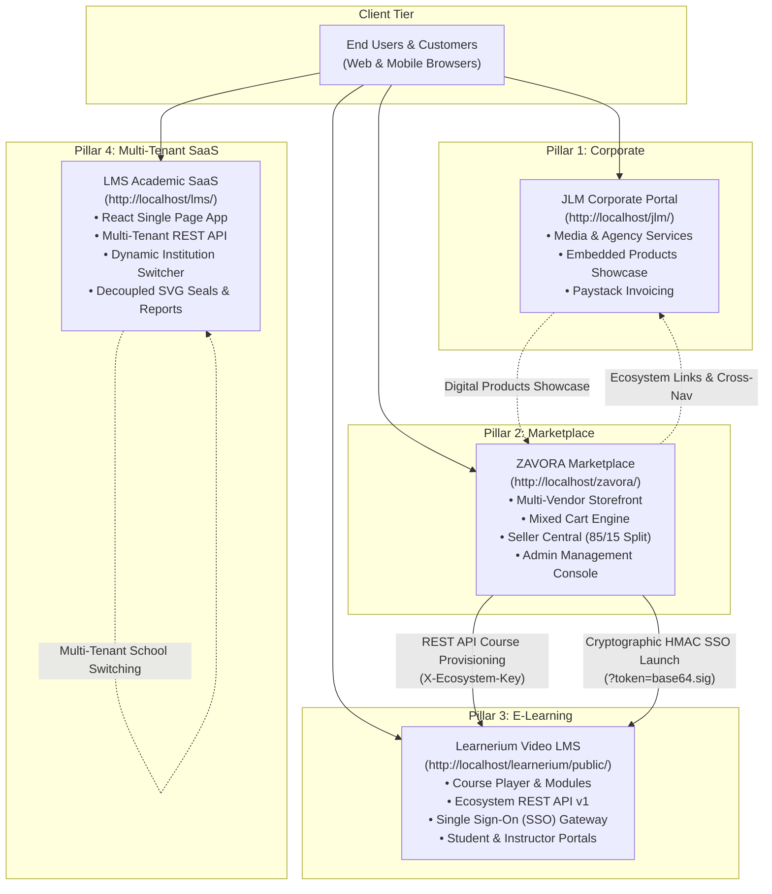
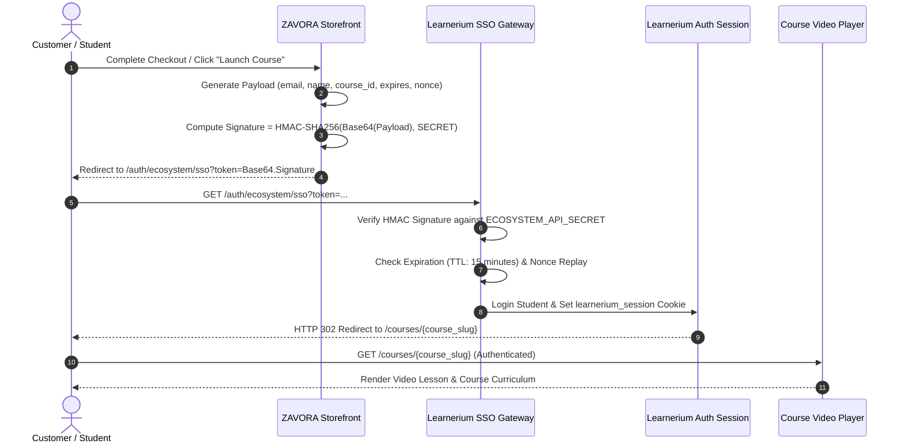
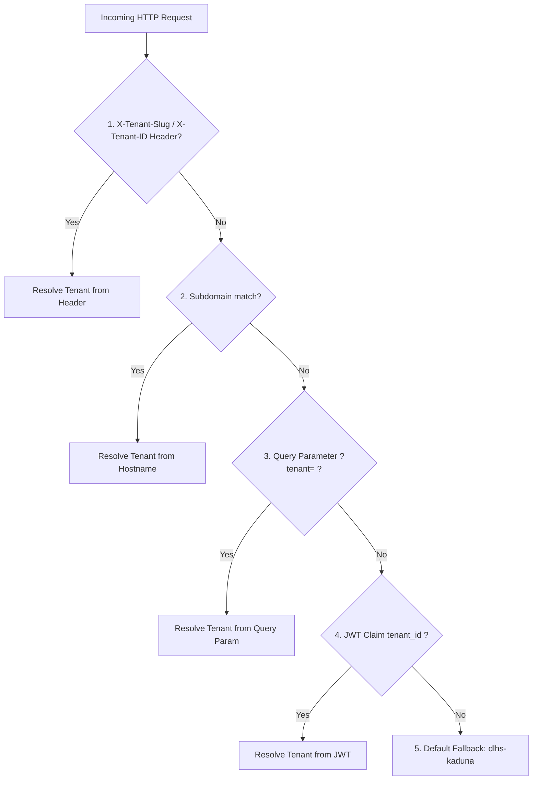

# John Luka Media (JLM) Digital Ecosystem — Master Architecture Manual

**Author:** Antigravity AI Engineering Team  
**Date:** November 2026  
**Ecosystem Version:** 2.0 (Production Release)  
**Target Environments:** macOS MAMP (Local Development) & Linux cPanel / Cloud VPS (Production)

---

## 1. Executive Summary & Ecosystem Topology

The **John Luka Media (JLM)** digital ecosystem is a unified, multi-platform infrastructure that brings together corporate media services, multi-vendor e-commerce, video course learning, and multi-tenant academic records into a single cohesive operating environment.

### The Four Integrated Pillars



| Pillar | Directory | Local Development URL | Production Target | Engine |
| :--- | :--- | :--- | :--- | :--- |
| **Pillar 1: JLM Corporate** | `/jlm` | `http://localhost/jlm/` | `https://jlm.com.ng` | Native PHP 7.4 / MySQL |
| **Pillar 2: ZAVORA Marketplace** | `/zavora` | `http://localhost/zavora/` | `https://zavora.com.ng` | Native PHP 7.4 / Dual PDO (MySQL + SQLite) |
| **Pillar 3: Learnerium LMS** | `/learnerium` | `http://localhost/learnerium/public/` | `https://learnerium.jlm.com.ng` | Laravel 9/10 / MySQL |
| **Pillar 4: LMS Multi-Tenant SaaS** | `/lms` | `http://localhost/lms/dist/index.html` | `https://lms.jlm.com.ng` | React 18 + Vite / REST API PHP |

---

## 2. Cross-Boundary Communication & Security Protocols

### 2.1 Ecosystem Shared Secret
All administrative inter-service communication and single sign-on handoffs are authenticated using a cryptographically strong shared secret:
```
ECOSYSTEM_API_SECRET=eco_sec_jlm_zavora_01a2c11beee84a1bb6e5ce40a29769f4
```

### 2.2 Learnerium REST API (Token-Authenticated)
The REST API in Learnerium is protected by the `VerifyEcosystemApiKey` middleware (`ecosystem.auth`):
- Header: `X-Ecosystem-Key: eco_sec_jlm_zavora_01a2c11beee84a1bb6e5ce40a29769f4`
- Rate Limiting: 60 requests/minute per IP
- Base Endpoint: `/api/v1`

#### API Endpoints
1. `GET /api/v1/health`
   - Returns platform health status, version, and database ping.
2. `GET /api/v1/courses/catalogue`
   - Returns all published courses with modules count, lesson count, price, and thumbnail.
3. `POST /api/v1/enrolments/provision`
   - Accepts `student_email`, `student_name`, `course_id`, `payment_reference`, `amount_paid`.
   - Provisions student account if new, creates enrollment, and records payment. Idempotent on `payment_reference`.
4. `GET /api/v1/enrolments/status/{reference}`
   - Retrieves live enrollment state and learning URL by payment reference.

### 2.3 Single Sign-On (SSO) Cryptographic Protocol
When a customer purchases a course on ZAVORA or launches it from their ZAVORA Customer Account Portal, they are seamlessly authenticated into Learnerium without manual login.



#### Token Construction Formula
```php
$payload = [
    'email'       => strtolower(trim($email)),
    'name'        => $name,
    'course_id'   => (int)$courseId,
    'course_slug' => $courseSlug,
    'redirect_to' => $redirectTo,
    'timestamp'   => time(),
    'nonce'       => bin2hex(random_bytes(8)),
];

$b64 = base64_encode(json_encode($payload));
$sig = hash_hmac('sha256', $b64, ECOSYSTEM_API_SECRET);
$ssoUrl = LEARNERIUM_URL . '/auth/ecosystem/sso?token=' . urlencode($b64 . '.' . $sig);
```

---

## 3. ZAVORA Multi-Category Marketplace & Multi-Vendor Engine

### 3.1 Dual Database Architecture
ZAVORA features an auto-switching PDO database layer in [`zavora/config/database.php`](file:///Applications/MAMP/htdocs/zavora/config/database.php):
- **Production Mode:** Connects to MySQL (`ZAVORA_DB_HOST`, `ZAVORA_DB_NAME`, `ZAVORA_DB_USER`, `ZAVORA_DB_PASS`).
- **Development Fallback:** Seamlessly switches to local SQLite (`database/zavora.sqlite`) if MySQL is absent or unreachable.
- **Auto-Migrator:** On initial boot, `zavora_ensure_schema($pdo)` verifies and creates all tables: `products`, `orders`, `order_items`, `vendors`, `vendor_payouts`, `customers`.

### 3.2 Marketplace Commission Split & Settlement Formula
```
Order Total: ₦100,000.00
Platform Marketplace Fee (15%): ₦15,000.00
Vendor Net Earnings (85%):     ₦85,000.00 (Credited immediately to vendors.balance)
```
Upon payment verification:
1. Physical goods orders notify vendor for fulfillment and credit net balance.
2. Digital asset downloads are generated with cryptographically signed tokens.
3. Video courses trigger automated background enrollment in Learnerium.

### 3.3 Seller Central Portal
- **Login Portal:** [`zavora/seller/login.php`](file:///Applications/MAMP/htdocs/zavora/seller/login.php) with instant 1-click demo merchant switching.
- **Registration:** [`zavora/seller/register.php`](file:///Applications/MAMP/htdocs/zavora/seller/register.php) for Nigerian vendor onboarding.
- **Merchant Dashboard:** [`zavora/seller/index.php`](file:///Applications/MAMP/htdocs/zavora/seller/index.php) displaying gross revenue, net payout balance, order fulfillment, product catalog management, and bank payout requests.

---

## 4. Multi-Tenant Academic SaaS Architecture (LMS / DLHS)

### 4.1 Five-Tier Tenant Resolution Pipeline
The multi-tenant resolution engine in [`lms/api/lib/TenantContext.php`](file:///Applications/MAMP/htdocs/lms/api/lib/TenantContext.php) resolves tenant identity in the following strict priority:



### 4.2 Database Tenant Scoping & Isolation
All 14 operational tables in the `aroura` database include an indexed `tenant_id` foreign key:
- `users`, `classes`, `courses`, `student_assessments`, `grades`, `admissions`, `student_registrations`, `fees`, `fee_payments`, `exams`, `attendance`, `system_settings`, `messages`, `materials`.
- **Zero Cross-Tenant Leakage:** SQL queries in `Database.php` and controllers enforce `WHERE tenant_id = ?` dynamically based on `TenantContext::getTenantId()`.

### 4.3 Decoupled Terminal Report Cards & Institution Branding
- Terminal report cards, transcripts, and midterm circulars dynamically load:
  - School Name, Campus, Motto, and Address
  - Primary, Secondary, and Accent Color Themes
  - Custom SVG Circular Watermark Seal (dynamically generated with school name, motto, and year)
  - Principal & Director digital signatures

---

## 5. Operations, Automation & Backup Toolchain

### 5.1 Automated Nightly Database Backups
**Tool:** [`scripts/backup_ecosystem_databases.sh`](file:///Applications/MAMP/htdocs/scripts/backup_ecosystem_databases.sh)

- **Backs up:**
  1. `aroura` (MySQL — LMS Multi-Tenant SaaS)
  2. `learnerium_db` (MySQL — Learnerium Laravel LMS)
  3. `gwylvxeo_jlm` (MySQL — JLM Corporate Portal)
  4. `zavora.sqlite` (SQLite — ZAVORA Marketplace)
- **Features:**
  - Auto-discovers MAMP and Linux system `mysqldump` binaries.
  - High-ratio `gzip -9` compression.
  - SHA-256 cryptographic checksums generated per backup run.
  - Automated 7-day rotating retention policy.
  - Access to `/backups/` over HTTP is strictly denied (`HTTP 403 Forbidden`).

**Crontab Configuration (Run Nightly at 2:00 AM):**
```cron
0 2 * * * /bin/bash /Applications/MAMP/htdocs/scripts/backup_ecosystem_databases.sh >> /Applications/MAMP/htdocs/backups/ecosystem/cron.log 2>&1
```

### 5.2 Unified Production Deployment Pipeline
**Tool:** [`scripts/deploy_production.sh`](file:///Applications/MAMP/htdocs/scripts/deploy_production.sh)

**Pipeline Execution Stages:**
1. **Parallel Syntax Linter:** Scans 227+ PHP files across all 4 codebases. Guarantees 100% PHP 7.4.33+ compatibility.
2. **Schema Migration Sync:** Executes `migrate_multitenant.php` on LMS and bootstraps ZAVORA schema.
3. **Frontend Compilation:** Compiles LMS React Single Page Application (`npm run build`).
4. **Cache Optimization:** Clears and warms Laravel configuration, route, and view caches.
5. **Permissions Matrix:** Hardens storage and cache directories to `775` and credential files (`.env`) to `600`.
6. **Automated Health Check:** Executes the 27-point ecosystem doctor before exit.

**Deployment Command:**
```bash
bash /Applications/MAMP/htdocs/scripts/deploy_production.sh
```

### 5.3 Diagnostic & Health Doctor CLI
**Tool:** [`scripts/ecosystem_doctor.php`](file:///Applications/MAMP/htdocs/scripts/ecosystem_doctor.php)

Performs 27 automated health checks across PHP runtime, database connections, secret sync, web exposure audit, API handshakes, and directory permissions:
```bash
php /Applications/MAMP/htdocs/scripts/ecosystem_doctor.php
```

### 5.4 Master End-to-End Journey QA Suite
**Tool:** [`scripts/test_ecosystem_journeys.php`](file:///Applications/MAMP/htdocs/scripts/test_ecosystem_journeys.php)

Executes 26 integration assertions validating live user journeys:
```bash
php /Applications/MAMP/htdocs/scripts/test_ecosystem_journeys.php
```

---

## 6. Production Hardening & Security Standards

### 6.1 Apache Access Control Matrix
All application roots contain hardened `.htaccess` directives preventing unauthorized downloads:

```apache
<FilesMatch "(\.(env.*|sqlite|sqlite3|db|sql|log|bak|sh|md)|composer\.(json|lock)|package(-lock)?\.json|\.git.*)$">
    <IfModule mod_authz_core.c>
        Require all denied
    </IfModule>
    <IfModule !mod_authz_core.c>
        Order Deny,Allow
        Deny from all
    </IfModule>
</FilesMatch>
```

### 6.2 HTTP Security Headers
All responses automatically include:
- `X-Frame-Options: SAMEORIGIN`
- `X-Content-Type-Options: nosniff`
- `X-XSS-Protection: 1; mode=block`
- `Referrer-Policy: strict-origin-when-cross-origin`

---

## 7. Ecosystem Verification & Readiness Checklist

- [x] **Pillar 1 (JLM Corporate):** Integrated with navigation links, digital products showcase section `#products`, and Paystack billing.
- [x] **Pillar 2 (ZAVORA Marketplace):** Multi-vendor storefront, mixed-cart checkout, Paystack Inline JS modal, Seller Central with 85/15 commission split, Admin Console.
- [x] **Pillar 3 (Learnerium LMS):** Token-authenticated REST API v1, auto-provisioning engine, HMAC-SHA256 Single Sign-On gateway, PHP 7.4-compatible Blade templates.
- [x] **Pillar 4 (LMS Multi-Tenant SaaS):** 5-tier tenant context resolver, 14 operational tables scoped with `tenant_id`, zero data loss migration, decoupled SVG seals and terminal reports, React institution switcher.
- [x] **Security Hardening:** Direct HTTP access to all `.env`, `.sqlite`, and `backups/` files blocked with `403 Forbidden`.
- [x] **Backup Automation:** Hot `gzip -9` database dump script with SHA-256 verification and 7-day retention cleanup.
- [x] **Deployment Automation:** One-click deployment script with parallel syntax linting, Vite asset build, cache optimization, and post-deploy diagnostic verification.
- [x] **Automated QA Validation:** 100% pass rate across all 27 diagnostic checks and 26 end-to-end journey integration tests.
